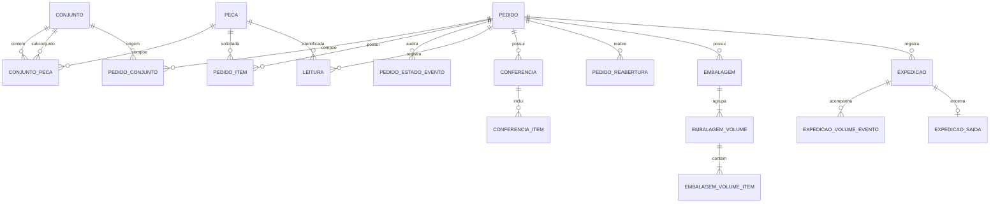

# Modelo de dados

O schema atual é definido pelos modelos SQLAlchemy em `app/instance/models.py`. A revisão inicial está em `migrations/versions/7a99af667db9_initial_schema.py`; as revisões incrementais adicionam embalagem e expedição.

A revisão `4f9c2a61d730` remove a coluna legada `peca.codigo_qr`. Antes de aplicá-la em qualquer implantação, execute `flask preflight-qr-migration`, confirme a revisão ativa com `flask db current` e o histórico esperado com `flask db heads`. A pré-verificação exige que a revisão atual seja exatamente `c8d42f6a1e90`; a pré-verificação e a migração interrompem a atualização se encontrarem códigos internos vazios, duplicados, com espaços externos ou caracteres de controle. A pré-verificação e a migração informam quantas etiquetas antigas precisam ser substituídas; essas etiquetas devem ser reimpressas, pois os QR antigos não são mantidos como aliases. O downgrade recria a coluna a partir do código interno e não recupera os valores QR antigos. O sistema não registra impressão física.

A exportação CSV usa o formato 3 sem coluna QR independente. A importação continua aceitando formato 2, descartando o conteúdo QR antigo e usando o código interno como identidade.

## Entidades e relações

| Entidade | Campos principais | Restrições/relações |
| --- | --- | --- |
| `Peca` | `id`, `codigo`, `descricao` | `codigo` é único e indexado, e é também o conteúdo QR da etiqueta gerada sob demanda. Relaciona-se a itens de conjuntos, itens de pedidos e leituras. |
| `Conjunto` | `id`, `codigo`, `descricao` | `codigo` é único e indexado. Seus componentes diretos são peças e/ou subconjuntos representados por `ConjuntoPeca`. |
| `ConjuntoPeca` | `id`, `conjunto_id`, `peca_id`, `subconjunto_id`, `quantidade` | Cada linha aponta exatamente para uma peça ou um subconjunto; cada combinação de conjunto e componente é única. Ciclos são rejeitados pela rota de inclusão. |
| `Pedido` | `id`, `codigo`, `status_fluxo`, `criado_em`, `prazo_entrega` | `codigo` é único e indexado. Data de criação e prazo são opcionais para preservar registros legados. Possui itens, leituras, tentativas, ciclos, embalagens, expedições e eventos de estado. |
| `PedidoConjunto` | `id`, `pedido_id`, `conjunto_id`, `codigo_conjunto`, `descricao_conjunto`, `quantidade` | Registra cada conjunto aplicado ao pedido, mantendo snapshots de código e descrição e a quantidade selecionada. |
| `PedidoItem` | `id`, `pedido_id`, `peca_id`, `quantidade_necessaria`, `quantidade_reconciliada`, `leituras_referencia_reconciliacao` | Chaves estrangeiras para pedido e peça; combinação pedido/peça única. Os campos de reconciliação controlam a base operacional sem alterar o histórico de leituras. |
| `Leitura` | `id`, `pedido_id`, `peca_id`, `ciclo`, `status`, `responsavel`, `timestamp` | Chaves estrangeiras para pedido e peça; status armazenado como Enum SQLAlchemy; leituras novas exigem responsável manual. `ciclo` e responsável podem ser nulos para registros legados. |
| `PedidoEstadoEvento` | `id`, `pedido_id`, `ciclo`, `estado_anterior`, `estado_novo`, `responsavel`, `timestamp` | Registra cada transição de estado com responsável manual e timestamp UTC; dados legados não são preenchidos por inferência. |
| `Conferencia` | `id`, `pedido_id`, `ciclo`, `conferente`, `resultado`, `timestamp` | Tentativa de checklist manual com resultado `aprovada` ou `reprovada`; mantém histórico por pedido. `ciclo` é nulo para tentativas legadas não classificáveis. |
| `ConferenciaItem` | `id`, `conferencia_id`, `pedido_item_id`, snapshots da peça, quantidades e motivo | Registra o resultado de cada linha. Código e descrição são snapshots para manter o histórico legível mesmo se o item for removido. |
| `PedidoReabertura` | `id`, `pedido_id`, `ciclo`, `timestamp` | Registra a reabertura e o início de um novo ciclo; combinação pedido/ciclo é única. |
| `Embalagem` | `id`, `pedido_id`, `ciclo`, `responsavel`, `timestamp`, `observacao` | Uma embalagem por pedido/ciclo, disponível após conferência aprovada; registra o responsável e horário UTC. |
| `EmbalagemVolume` | `id`, `embalagem_id`, `numero` | Volume numerado dentro da embalagem; números são únicos por embalagem. |
| `EmbalagemVolumeItem` | `id`, `volume_id`, `pedido_item_id`, snapshots da peça, `quantidade` | Conteúdo por volume e peça; quantidade positiva e única por item no volume. O snapshot preserva código e descrição. |
| `Expedicao` | `id`, `pedido_id`, `embalagem_id`, `ciclo`, `placa_veiculo`, `motorista_transportadora` | Dados do veículo/transportadora vinculados à embalagem e ao ciclo; uma expedição por pedido/ciclo. |
| `ExpedicaoVolumeEvento` | `id`, `expedicao_id`, `embalagem_volume_id`, `acao`, `responsavel`, `timestamp`, `observacao` | Evento auditável `carregado` ou `revertido` por volume; uma restrição `CHECK` rejeita outras ações. O estado atual do volume decorre do último evento. |
| `ExpedicaoSaida` | `id`, `expedicao_id`, `responsavel`, `timestamp`, `observacao` | Confirma a saída uma única vez; após esse evento o pedido fica expedido e bloqueado. |

## Status das leituras

O Enum Python `StatusLeitura` contém `SUCESSO`, `DUPLICADA` e `FORA_DO_PEDIDO`. A rota JSON serializa seus valores em minúsculas com sublinhados: `sucesso`, `duplicada` e `fora_do_pedido`. A migração inicial define os valores persistidos como nomes do Enum (`SUCESSO`, `DUPLICADA`, `FORA_DO_PEDIDO`).

Uma peça conhecida mas não incluída no pedido produz leitura `FORA_DO_PEDIDO`. Um código interno que não corresponde a peça cadastrada não cria leitura. Uma leitura além da quantidade necessária é mantida no histórico como `DUPLICADA`.

## Cálculo do progresso

`Pedido.progresso()` soma as quantidades necessárias. Antes de uma reconciliação, conta apenas as leituras de sucesso por peça. Após uma conferência reprovada, a quantidade validada operacional é a quantidade reconciliada mais as leituras de sucesso posteriores ao marco salvo no item, limitada à quantidade necessária. As leituras anteriores permanecem no histórico, mas não são contadas novamente.

O resultado contém:

- `total_necessario`: soma das quantidades dos itens;
- `quantidade_validada`: soma das quantidades limitadas por item;
- `percentual`: progresso em porcentagem, arredondado a duas casas decimais;
- `status`: `sem_itens` quando o total é zero, `finalizado` quando todas as unidades necessárias foram validadas, ou `em_andamento` nos demais casos.

`Pedido.progresso_por_item()` aplica a mesma regra e devolve a peça, quantidade necessária, quantidade validada e percentual de cada item. Esses valores são calculados em memória e não persistidos como colunas.

## Conferência e reconciliação

A conferência só é permitida quando o progresso operacional está completo. O conferente informa a quantidade física de cada item e um motivo para cada diferença. Uma tentativa aprovada libera o pedido; uma reprovada armazena snapshots e atualiza a base reconciliada de cada item, que serve para orientar a separação complementar. Uma nova conferência verifica todos os itens novamente. Reabrir pedido liberado zera a base operacional e cria um novo ciclo de separação, sem apagar eventos anteriores.

## Histórico e ciclos do pedido

`Pedido.historico()` projeta uma linha do tempo a partir de `Leitura`, `PedidoEstadoEvento`, `Conferencia`, `ConferenciaItem` divergentes, `PedidoReabertura`, `Embalagem` e eventos de `Expedicao`. A ordenação usa timestamp e critérios estáveis para eventos simultâneos. Novos eventos recebem o ciclo atual, iniciado em 1 e incrementado a cada reabertura. Os eventos anteriores à implantação mantêm `ciclo = NULL`; não há dados suficientes para classificá-los com segurança. A interface explicita UTC, convenção utilizada pelos timestamps atuais (`datetime.utcnow`).

## Indicadores

`app/instance/indicadores.py` agrega dados do intervalo e estado selecionados. Durações só contam ciclos com início conhecido e transição registrada para `expedido`. O prazo é opcional; pedidos sem prazo não entram nos totais de pontualidade. Registros sem data de criação e eventos legados não são retroativamente estimados.

## Embalagem, carregamento e saída

Uma embalagem é registrada somente após uma conferência aprovada no ciclo atual. Cada volume contém pelo menos uma peça; todas as quantidades dos itens do pedido devem ser distribuídas exatamente entre os volumes, sem sobra ou falta. O código e a descrição são snapshots; o QR Code continua representando o tipo de material, não uma unidade física.

O carregamento consome os volumes da embalagem vigente. Cada volume pode ser marcado como carregado e, antes da saída, revertido; as duas ações são mantidas como eventos com responsável e horário UTC. Placa e motorista/transportadora são obrigatórios ao criar a expedição no primeiro carregamento e ficam registrados para aquele ciclo.

A saída é uma confirmação separada, permitida somente quando todos os volumes estiverem carregados. Ela registra responsável e horário UTC e muda o estado do pedido para `expedido`. Antes da saída, a reabertura pode encerrar diretamente o ciclo em andamento; embalagens e eventos antigos permanecem no histórico. Depois da saída, o estado é terminal no MVP.

## Composição e expansão de conjuntos

Um conjunto pode conter peças e subconjuntos, com quantidades positivas definidas por associação. A expansão recursiva multiplica as quantidades em cada nível e consolida as ocorrências por peça. A rota impede ciclos antes de salvar uma associação. Ao aplicar a composição a um pedido, as quantidades expandidas são somadas às linhas existentes e ficam materializadas como `PedidoItem`; mudanças posteriores no catálogo não alteram os itens já preparados. A inclusão é bloqueada depois de qualquer leitura ou tentativa de conferência.

## Integridade e ciclo de vida

As relações `Conjunto.componentes`, `Pedido.itens`, `Pedido.composicoes` e as linhas de conferência usam cascata de ORM para seus itens dependentes. A exclusão de conjunto referenciado como subconjunto ou registrado em composição de pedido é barrada pelas rotas; também é barrada a exclusão de pedido com leituras e de peça com associações. As quantidades positivas são validadas nas rotas; `PedidoConjunto` também tem restrição `CHECK` no schema.