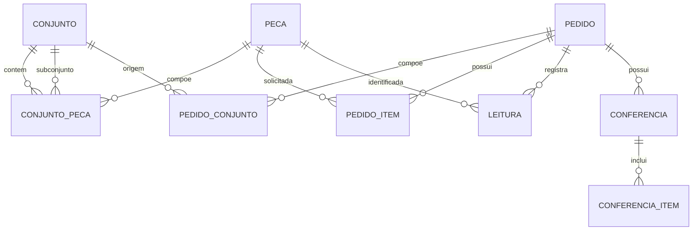

# Modelo de dados

O schema atual é definido pelos modelos SQLAlchemy em `app/instance/models.py`. A revisão inicial do banco está em `migrations/versions/9aac0ccff198_initial_schema.py`.

## Entidades e relações

| Entidade | Campos principais | Restrições/relações |
| --- | --- | --- |
| `Peca` | `id`, `codigo`, `descricao`, `codigo_qr` | `codigo` e `codigo_qr` são únicos e indexados. Relaciona-se a itens de conjuntos, itens de pedidos e leituras. |
| `Conjunto` | `id`, `codigo`, `descricao` | `codigo` é único e indexado. Seus componentes diretos são peças e/ou subconjuntos representados por `ConjuntoPeca`. |
| `ConjuntoPeca` | `id`, `conjunto_id`, `peca_id`, `subconjunto_id`, `quantidade` | Cada linha aponta exatamente para uma peça ou um subconjunto; cada combinação de conjunto e componente é única. Ciclos são rejeitados pela rota de inclusão. |
| `Pedido` | `id`, `codigo`, `status_fluxo` | `codigo` é único e indexado. Possui itens, leituras e tentativas de conferência. Estados do fluxo: `separacao`, `aguardando_conferencia`, `correcao` e `liberado`. |
| `PedidoConjunto` | `id`, `pedido_id`, `conjunto_id`, `codigo_conjunto`, `descricao_conjunto`, `quantidade` | Registra cada conjunto aplicado ao pedido, mantendo snapshots de código e descrição e a quantidade selecionada. |
| `PedidoItem` | `id`, `pedido_id`, `peca_id`, `quantidade_necessaria`, `quantidade_reconciliada`, `leituras_referencia_reconciliacao` | Chaves estrangeiras para pedido e peça; combinação pedido/peça única. Os campos de reconciliação controlam a base operacional sem alterar o histórico de leituras. |
| `Leitura` | `id`, `pedido_id`, `peca_id`, `status`, `timestamp` | Chaves estrangeiras para pedido e peça; status armazenado como Enum SQLAlchemy; timestamp recebe `datetime.utcnow` como padrão. |
| `Conferencia` | `id`, `pedido_id`, `conferente`, `resultado`, `timestamp` | Tentativa de checklist manual com resultado `aprovada` ou `reprovada`; mantém histórico por pedido. |
| `ConferenciaItem` | `id`, `conferencia_id`, `pedido_item_id`, snapshots da peça, quantidades e motivo | Registra o resultado de cada linha. Código e descrição são snapshots para manter o histórico legível mesmo se o item for removido. |

## Status das leituras

O Enum Python `StatusLeitura` contém `SUCESSO`, `DUPLICADA` e `FORA_DO_PEDIDO`. A rota JSON serializa seus valores em minúsculas com sublinhados: `sucesso`, `duplicada` e `fora_do_pedido`. A migração inicial define os valores persistidos como nomes do Enum (`SUCESSO`, `DUPLICADA`, `FORA_DO_PEDIDO`).

Uma peça conhecida mas não incluída no pedido produz leitura `FORA_DO_PEDIDO`. Um conteúdo que não corresponde a peça por QR Code nem por código interno não cria leitura. Uma leitura além da quantidade necessária é mantida no histórico como `DUPLICADA`.

## Cálculo do progresso

`Pedido.progresso()` soma as quantidades necessárias. Antes de uma reconciliação, conta apenas as leituras de sucesso por peça. Após uma conferência reprovada, a quantidade validada operacional é a quantidade reconciliada mais as leituras de sucesso posteriores ao marco salvo no item, limitada à quantidade necessária. As leituras anteriores permanecem no histórico, mas não são contadas novamente.

O resultado contém:

- `total_necessario`: soma das quantidades dos itens;
- `quantidade_validada`: soma das quantidades limitadas por item;
- `percentual`: progresso em porcentagem, arredondado a duas casas decimais;
- `status`: `sem_itens` quando o total é zero, `finalizado` quando todas as unidades necessárias foram validadas, ou `em_andamento` nos demais casos.

`Pedido.progresso_por_item()` aplica a mesma regra e devolve a peça, quantidade necessária, quantidade validada e percentual de cada item. Esses valores são calculados em memória e não persistidos como colunas.

## Conferência e reconciliação

A conferência só é permitida quando o progresso operacional está completo. O conferente informa a quantidade física de cada item e um motivo para cada diferença. Uma tentativa aprovada libera o pedido; uma reprovada armazena snapshots e atualiza a base reconciliada de cada item, que serve para orientar a separação complementar. Uma nova conferência verifica todos os itens novamente. Reabrir pedido liberado zera a base operacional e cria um novo ciclo de separação, sem apagar eventos anteriores.

## Composição e expansão de conjuntos

Um conjunto pode conter peças e subconjuntos, com quantidades positivas definidas por associação. A expansão recursiva multiplica as quantidades em cada nível e consolida as ocorrências por peça. A rota impede ciclos antes de salvar uma associação. Ao aplicar a composição a um pedido, as quantidades expandidas são somadas às linhas existentes e ficam materializadas como `PedidoItem`; mudanças posteriores no catálogo não alteram os itens já preparados. A inclusão é bloqueada depois de qualquer leitura ou tentativa de conferência.

## Integridade e ciclo de vida

As relações `Conjunto.componentes`, `Pedido.itens`, `Pedido.composicoes` e as linhas de conferência usam cascata de ORM para seus itens dependentes. A exclusão de conjunto referenciado como subconjunto ou registrado em composição de pedido é barrada pelas rotas; também é barrada a exclusão de pedido com leituras e de peça com associações. As quantidades positivas são validadas nas rotas; `PedidoConjunto` também tem restrição `CHECK` no schema.
